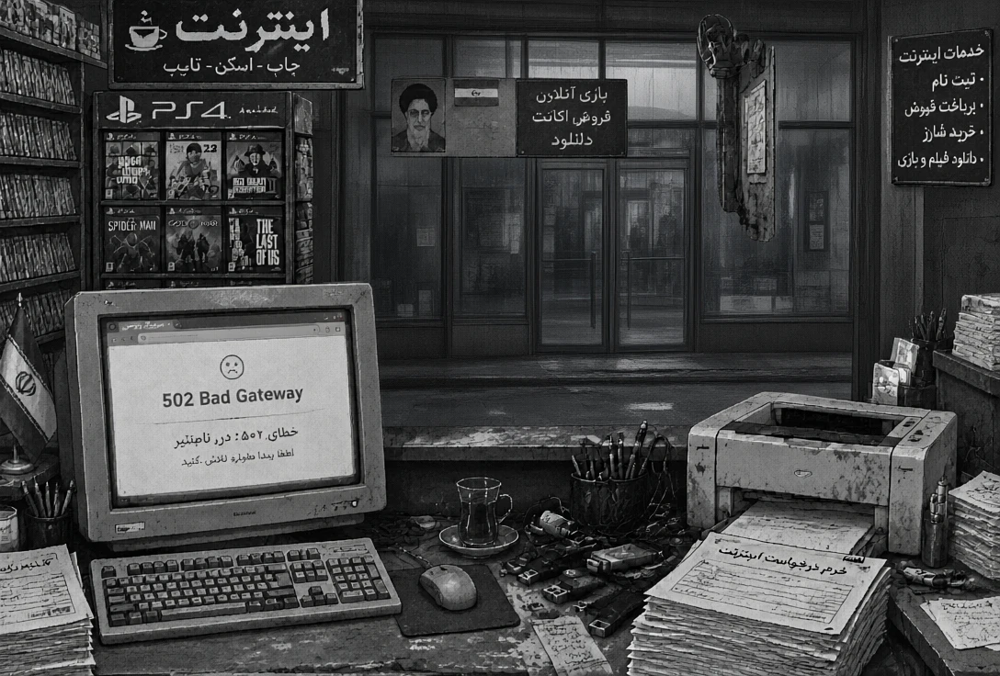

```markdown
<div align="center">

# 🌐 !سایت بسته است | The Site is Down!
### A Cynical Desk Simulator in an Iranian Internet Café
### شبیه‌ساز بقا و مدیریت بحران در کافی‌نت ایرانی

[](https://itworksonmypc4077.github.io/the-site-is-down/)
[](https://github.com/itworksonmypc4077)
[](#)
[](#)

<br/>



<br/>

> **"The queue is endless, deadlines are suffocating, and the government portal insists it never existed in the first place."**  
> **«صف شلوغه، مهلت ثبت‌نام داره تموم میشه و سامانه هم ادعا می‌کنه چنین صفحه‌ای اصلاً وجود نداره!»**

---

### 🕹️ Quick Launch / اجرای سریع
[](https://itworksonmypc4077.github.io/the-site-is-down/)

</div>

---

## ⌨️ Controls & Hotkeys | کلیدهای میانبر

| Key / کلید | Action (English) | بخش مربوطه (فارسی) | Effect / کارکرد |
| :---: | :--- | :--- | :--- |
| <kbd>1</kbd> | 🖥️ **Main Monitor** | مانیتور اصلی | Portals, registration & triage / سامانه‌ها و ثبت مدارک |
| <kbd>2</kbd> | 🖨️ **Printer** | دستگاه پرینتر | Paper reload & print output / پرینت و شارژ کاغذ |
| <kbd>3</kbd> | ☕ **Hot Tea** | استکان چای | Reduces Stress by -8 / کاهش استرس و فشار اعصاب |
| <kbd>4</kbd> | 📦 **USB Shelf** | قفسه و فلش‌ها | Flash drives & customer files / فایل‌های ارسالی مشتری |
| <kbd>5</kbd> | 📄 **Documents** | پوشه مدارک | Forms, IDs, national codes / بررسی شناسنامه و فرم‌ها |
| <kbd>6</kbd> | 🚪 **Entrance Door** | درب ورود/خروج | Call next customer / صدا زدن مشتری بعدی |
| <kbd>Tab</kbd> | 🔄 **Cycle Station** | چرخش سریع | Quick switch between stations / سوئیچ بین بخش‌ها |
| <kbd>Esc</kbd> | ⏸️ **Pause / Menu** | منوی توقف | Pause game & autosave / توقف و ذخیره لحظه‌ای |

---

## 🇮🇷 نسخه فارسی (برای مطالعه کلیک کنید)

<details open>
<summary><b>🎭 ۱. داستان و کاراکترها</b></summary>
<br>

* **نیما (کاراکتر اصلی):** گیمری تیزبین، خسته و پر از کنایه. بچه‌های تیم دیسکوردش فکر می‌کنن مهندس مایکروسافته، اما مشتری‌های محل باور دارن کلید سرورهای کل کشور زیر کیبورد نیماست!
* **مشتری‌ها:**
  * **آقای رحیمی:** بازنشسته‌ای عجول که رمز فیش حقوقی یادش رفته و فکر می‌کنه سایت به خاطر اون قفل شده!
  * **خانم نادری:** مادری نگران برای ثبت‌نام مدرسه فرزندش در سامانه‌ای که مدام خطای ۵۰۲ بالا می‌آورد.
</details>

<details>
<summary><b>⚙️ ۲. جزئیات فنی و مهندسی</b></summary>
<br>

* **Zero Dependencies:** بدون هیچ پکیج اضافه یا فریم‌ورک‌های سنگین (Pure Vanilla JS/CSS).
* **معماری ماژولار و سبک:** آیکون‌ها و فونت محلی استخراج‌شده در پوشه `assets/` (کاهش حجم فایل اصلی به ~۱۱۴ کیلوبایت).
* **سیستم ذخیره‌سازی:** ذخیره‌سازی خودکار و لحظه‌ای روی `localStorage`.
* **پشتیبانی کامل فارسی:** چیدمان دقیق RTL و فونت اختصاصی.
</details>

<details>
<summary><b>🚀 ۳. نحوه اجرای محلی (روی سیستم)</b></summary>
<br>

```bash
# ۱. کلون کردن ریپازیتوری
git clone https://github.com/itworksonmypc4077/the-site-is-down.git

# ۲. رفتن به پوشه و باز کردن مستقیم در مرورگر
cd the-site-is-down
start index.html
```
</details>

---

## 🇬🇧 English Version (Click to Expand)

<details>
<summary><b>📖 1. Story & Lore</b></summary>
<br>

* **Nima (Protagonist):** A cynical gamer blessed with sharp pattern recognition and cursed with technical empathy. His gaming raid team thinks he works in top-tier IT; his customers believe he personally manages every government portal in the country.
* **The Customers:**
  * **Mr. Rahimi:** An anxious retiree trying to retrieve his pension receipt while forgetting his password for the 4th time.
  * **Mrs. Naderi:** Desperately trying to register her child for school on a portal experiencing rolling 502 Bad Gateway timeouts.
</details>

<details>
<summary><b>🛠️ 2. Technical Highlights</b></summary>
<br>

* **Zero External Dependencies:** Built with pure Vanilla JS and semantic HTML5/CSS3. Completely offline-capable.
* **Streamlined Assets:** Dedicated `assets/` directory housing decoupled assets, keeping the root bundle featherlight (~114 KB).
* **State Machine & Autosave:** Real-time persistence backed by browser `localStorage`.
* **First-Class Bi-directional Layout:** Native RTL UI tailored for Persian typography alongside mirrored EN structures.
</details>

<details>
<summary><b>💻 3. Local Setup & Contribution</b></summary>
<br>

```bash
# Clone the repository
git clone https://github.com/itworksonmypc4077/the-site-is-down.git

# Open the standalone build in any modern browser
cd the-site-is-down
# Windows
start index.html
# macOS / Linux
open index.html || xdg-open index.html
```
</details>

<details>
<summary><b>❓ FAQ / Frequently Asked Questions</b></summary>
<br>

* **Q: Why does my stress reach 100 so fast?**  
  *A:* You kept arguing with bureaucracy without sipping your tea! Press <kbd>3</kbd> regularly to de-escalate stress.
* **Q: How many levels are available?**  
  *A:* The initial release features 5 distinct customers and 15 escalating crisis missions.
</details>

---

<div align="center">

Crafted with ☕ and technical sarcasm by **[@itworksonmypc4077](https://github.com/itworksonmypc4077)**  
*“It worked on my machine, so good luck!”*

</div>
```