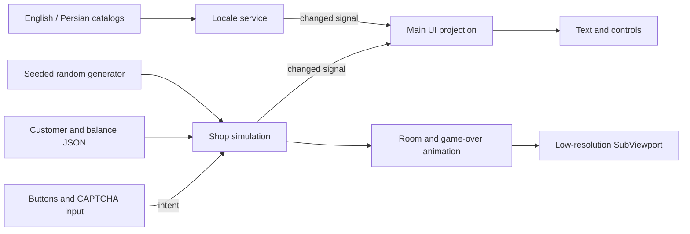
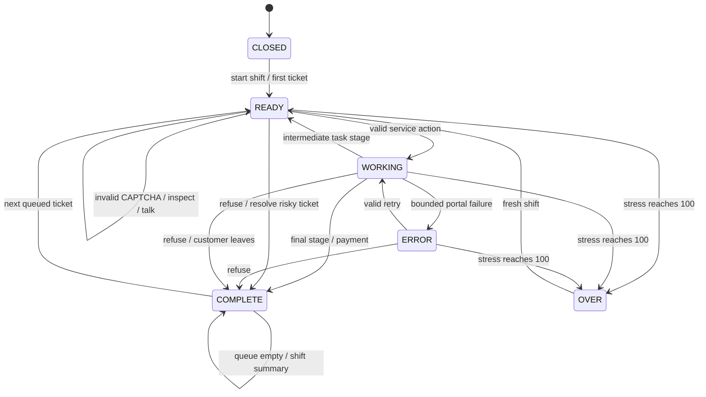

# Core system architecture

> Historical Godot design, not the current HTML/JavaScript implementation. See [README](../README.md) and [current version notes](SHIFT_UPDATE.md).

## Runtime choice

Use **Godot 4.4+ with GDScript** for the game frontend. The supplied project targets the 4.4 API surface rather than depending on a newly introduced feature. Python 3.10+ is a separate balancing/reference tool. The runtime does not call Python, install plugins or access the network.

The UI uses Godot's container layout, translation resources and bidirectional text handling. Programmatic `Translation.add_message` registration lets the same JSON catalog be audited by Python. Room art uses a small SubViewport; UI controls remain at the main viewport resolution. Technical behavior was checked against the official references at the end of this document; the project itself still requires a Godot runtime test.

## Current files and responsibility

| File | Responsibility |
|---|---|
| `project.godot` | Main scene, two autoloads, compatibility renderer, viewport sizing |
| `scenes/main.tscn` | Thin root scene loading the UI template |
| `scripts/localization.gd` | JSON catalogs → TranslationServer, locale, digit normalization, UI settings |
| `scripts/shop.gd` | Authoritative shift state, queue, active ticket, time, RNG, stress, money, outcomes |
| `scripts/main.gd` | Widgets, intent dispatch, localized projection of state |
| `scripts/room.gd` | Procedural room art and terminal keyboard animation |
| `shaders/crt.gdshader` | Optional art-only scanlines, vignette and low-amplitude flicker |
| `data/customers.json` | Eight ticket definitions and localized content references |
| `data/balance.json` | Shared tuning constants |
| `data/strings.json` | English and Persian catalogs with identical keys |
| `tests/smoke.gd` | Headless checks against actual GDScript state transitions |
| `python/simulation.py` | Fast reference model and seeded policy experiments |
| `tests/test_simulation.py` | Model invariants, catalog parity, content and path checks |

## Data flow



UI callbacks never decide payouts, stress, failures or inspection results. They submit `action`, `inspect`, `talk`, `tea`, `refuse` or `toggle_pause`. Shop checks state before mutating. Locale switching refreshes display without resetting a ticket, advancing random state or editing CAPTCHA input.

The bootstrap emits a single `changed` signal during active frames. This is deliberately simple; in a larger build, split out `ticket_changed`, `progress_changed`, `stress_changed` and `shift_ended` to avoid rebuilding unchanged text every frame. Preserve the intent/state boundary when doing so.

## State machine



`COMPLETE` with a nonempty customer is the read-outcome/handoff state. `COMPLETE` with an empty customer is the closing summary. Both freeze simulation time. Expired patience can complete any active ticket; elapsed shift time closes any active phase. These global transitions are implemented in `_process` before work progression. `paused` is an orthogonal boolean and blocks all gameplay intents and timer advancement while keeping language/effects controls available.

The update order is: decrement time/cooldowns/patience → ambient stress → check terminal stress → check closing → check abandonment → apply complaint pulses → progress work. After a stress event, stop if game over occurred. This prevents a same-frame payout after terminal stress.

All job and frame timers use seconds. A four-second simulated task can finish on a frame with a large delta; the template does not carry excess delta into a second task stage. There is no offline progression. Tea cools down only while the simulation is active. Do not add scene-local timers that bypass pause.

## Ticket contract

```json
{
  "id": "mina",
  "name": "name_mina",
  "kind": "print",
  "request": "request_print",
  "clue": "clue_print",
  "response": "response_print",
  "patience": 65,
  "fee": 15,
  "risky": false
}
```

`kind` is one of `print`, `portal`, `usb`, `console`, `suspicious`. Monetary values are integer fictional credits. Identity and strings are separate so save data and logic never depend on translated prose. On shift start, deep-copy tickets and assign the runtime-only `undercover` flag to risky tickets with 50% probability. Never expose that field in the clue panel.

The queue shuffle and outcome rolls use one `RandomNumberGenerator` with a captured `run_seed`. Reproducing a run requires the same seed **and action sequence**, engine version and content. Python uses a different RNG implementation and simplified time driver; identical seeds do not promise matching Godot outcomes. Share balance data and invariants, not an assumed bit-identical simulation.

## Extending the mini-games

Keep the current stage interfaces while replacing the stage widgets. A full service scene should expose `begin(ticket, difficulty)`, `cancel()` and signals `completed(result)` / `failed(reason)` / `stress_requested(amount)`. Shop applies results and consumes the active ticket once. Scene UI must not write money directly.

Suggested full result record:

```json
{"ticket_id":"mina", "quality":0.92, "consumables":{"paper":2}, "flags":["stamp_preserved"]}
```

Add one `ServiceHost` scene and a registry mapping service kinds to PackedScenes. Introduce a result-consumed guard before parallel workstations. Replace the monolithic prototype Shop with these components only as the feature count requires it:

- `ShiftDirector`: arrivals, closing, authored outages and day rules.
- `CustomerQueue`: waiting/active/completed tickets and patience.
- `StressSystem`: clamping, recovery and terminal event.
- `ServiceHost`: owns the selected mini-game scene and lifecycle.
- `DialogueDirector`: localized line keys, choices and relationship flags.
- `InspectionDirector`: announced policy, request evidence and outcomes.
- `Ledger`: integer transactions, consumables, upgrades and closing costs.

## Persistence plan

Currently only language and reduced-effects settings are written to `user://settings.cfg`. A new shift resets gameplay. There is no campaign save/resume implementation hidden behind this UI.

For campaign saves, use a versioned record with `schema_version`, day, credits, stress, reputation, upgrades, relationship flags and resolved ticket IDs. Save at shift boundaries first. Add mid-shift saves only when a job can serialize its stage, elapsed time, CAPTCHA, retry count, failure roll and RNG state without rerolling on load. Write a temporary file, validate it, then replace the prior save; retain one backup. Reject or migrate unknown schemas explicitly. Never save fully translated display strings or real customer data.

## Validation strategy

Python tests verify bounded retries even when RNG always fails, digit normalization, terminal stress, inspection branches, reproducibility, translation placeholders, content references and resource paths. The Python simulator is not a substitute for Godot import, parsing, runtime tests or GUI inspection.

`godot/tests/smoke.gd` is provided for an engine-side check of normal task completion, pause, bounded portal retries and terminal stress. Run the editor import before the smoke script so fonts and resources are imported. For distribution, include JSON files in export filters and verify an exported build rather than relying on the editor's filesystem.

Before release, fail the content build on missing keys, malformed customer kinds, duplicate IDs or incompatible save versions. Add golden screenshots in both languages for every major state, with a human reviewer checking Persian joining and punctuation. Confirm input while the keyboard layout is Persian, not only pasted strings.

## Official technical references

These are versioned documentation references, consulted on 13 October 2026:

- Translation resources and `add_message`: `https://docs.godotengine.org/en/4.4/classes/class_translation.html`
- Runtime language selection, named placeholders, bidi and UI mirroring: `https://docs.godotengine.org/en/4.4/tutorials/i18n/internationalizing_games.html`
- Control layout direction, containers and focus: `https://docs.godotengine.org/en/4.4/classes/class_control.html`
- Resolution and stretch behavior: `https://docs.godotengine.org/en/4.4/tutorials/rendering/multiple_resolutions.html`

Use the Godot 4 font and Theme APIs in the supplied code; older DynamicFont examples sometimes remain in tutorial prose and should not be copied into a Godot 4 project.
